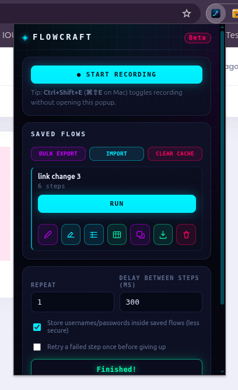
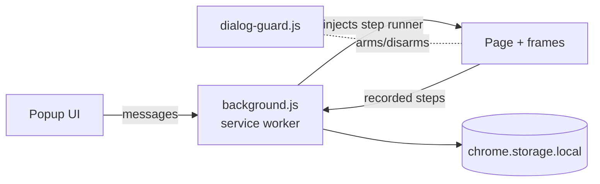

<div align="center">

# Flowcraft

### Record, edit and replay browser flows — data-driven, zero dependencies, 100% local.


[](https://github.com/Soykat25/flowcraft-extension/stargazers)
[](https://github.com/Soykat25/flowcraft-extension/commits/main)
[](https://soykat25.github.io/flowcraft-extension/)

<br>

<a href="https://soykat25.github.io/flowcraft-extension/">
  
</a>

<br>

[Quick start](#quick-start) · [Features](#features) · [Data-driven runs](#data-driven-runs) · [How it works](#how-it-works) · [FAQ](#faq) · [Docs](#documentation) · [Contributing](#contributing)

</div>

Flowcraft is a Chrome/Edge extension that records your clicks and form inputs on any site, saves them as named **flows**, and replays them — optionally once per row of a spreadsheet. Think Selenium IDE or iMacros, with no backend, no account, no telemetry and no third-party code.

> [!WARNING]
> **Beta, single-developer software** with no formal security audit. Only automate sites and accounts you are authorized to test. Read [Security & privacy](docs/security.md) before using it on anything sensitive.

<div align="center">
  
</div>

<!-- TODO: add a demo GIF here, e.g. docs/assets/demo.gif -->

## Quick start

```bash
git clone https://github.com/Soykat25/flowcraft-extension.git
```

1. Open `chrome://extensions` (or `edge://extensions`) and turn on **Developer mode**.
2. Click **Load unpacked** and select the cloned folder.
3. Pin the extension, open your page, click the icon → **● Start recording**.
4. Click through your flow, press **Stop**, name it, **Save flow**, then **Run**.

No build step — every file is plain JS/HTML/CSS. After pulling updates, hit the reload icon on Flowcraft's card at `chrome://extensions`.

**Shortcut:** `Ctrl+Shift+E` (`⌘⇧E` on Mac) starts/stops recording without opening the popup.

## Features

| | |
|---|---|
| 🎙️ **Record** | Clicks, form input, checkbox/radio toggles, `Enter`/`Escape`, native dialogs |
| ✏️ **Step editor** | Reorder, edit or delete steps; add manual `Wait`, `Assert visible` and `Assert text` steps |
| 📊 **Data-driven runs** | One run per spreadsheet row (`.xlsx`, CSV or JSON), with a per-row **Repeat** column |
| 🔁 **Smart replay** | Playwright-style auto-waiting: elements must be visible, enabled, stable and uncovered |
| 🛡️ **Safe by default** | Usernames/passwords are never stored unless you opt in; you're prompted at run time |
| 📦 **Share flows** | Export one flow or bulk-export many as JSON; re-importing never creates duplicates |
| 🧪 **Run history** | Per-run results, failure screenshots (copy/save), retry-once option |
| 🔒 **Private** | No network requests, no analytics, no third-party code — even the `.xlsx` reader is hand-written |

## Data-driven runs

1. Click the Excel icon on a flow to **download a data template** (one column per input step).
2. Fill one row per run; add a **Repeat** value to run a row more than once.
3. Click **Run with data** and pick the file.

The filename must match the template exactly — a deliberate guard against running a flow with the wrong dataset. Details in the [usage guide](docs/usage.md#data-driven-replay).

## How it works



`content.js` records interactions and builds CSS selectors; `background.js` holds state and drives replay by injecting a step function into the right frame; `dialog-guard.js` handles native dialogs. More in [Architecture](docs/architecture.md).

## Known limitations

- **Selectors can break** on sites with random/hashed class names. Prefer stable `id` / `data-testid` / `name`.
- **CAPTCHA / 2FA / OTP / bot protection** will intentionally resist automation.
- **New tabs/windows** opened by a click aren't followed during replay.
- **Hover, drag, canvas** interactions and keys other than `Enter`/`Escape` aren't recorded.
- **Keypress replay is synthetic**, so it won't trigger native browser defaults.

## FAQ

<details>
<summary><b>Does Flowcraft send my data anywhere?</b></summary>

No. It makes no network requests and has no telemetry. Everything lives in `chrome.storage.local` on your machine.
</details>

<details>
<summary><b>Why does it need access to all sites?</b></summary>

Recording and replay must run on whatever site you point them at, so there's no fixed site list. See the [permissions table](docs/security.md).
</details>

<details>
<summary><b>Are passwords saved in exported flows?</b></summary>

Not by default — credential fields are blanked before saving. If you enable "Store usernames/passwords", they are kept in plaintext and included in exports. See [Security & privacy](docs/security.md#passwords--secrets).
</details>

<details>
<summary><b>Can I run flows in CI or headless?</b></summary>

Not directly — flows run from the extension in a real browser. The exported JSON is plain and could be converted to Playwright or Selenium; see the discussion in [issues](https://github.com/Soykat25/flowcraft-extension/issues).
</details>

## Documentation

- [**User manual**](https://soykat25.github.io/flowcraft-extension/) — illustrated step-by-step guide (GitHub Pages)
- [Usage guide](docs/usage.md) — every popup control, data-driven replay, step types
- [Security & privacy](docs/security.md) — permissions, passwords, what to keep out of Git
- [Architecture](docs/architecture.md) — how it works, file map
- [Changelog](CHANGELOG.md)

## Contributing

Bug reports and PRs are welcome — see [CONTRIBUTING.md](CONTRIBUTING.md). For vulnerabilities, see [SECURITY.md](SECURITY.md).

## License

[MIT](LICENSE) © 2026 Soykat25
